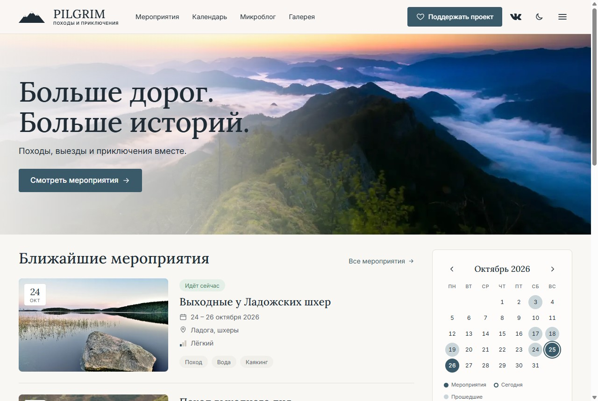
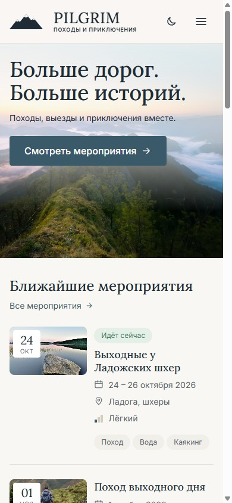
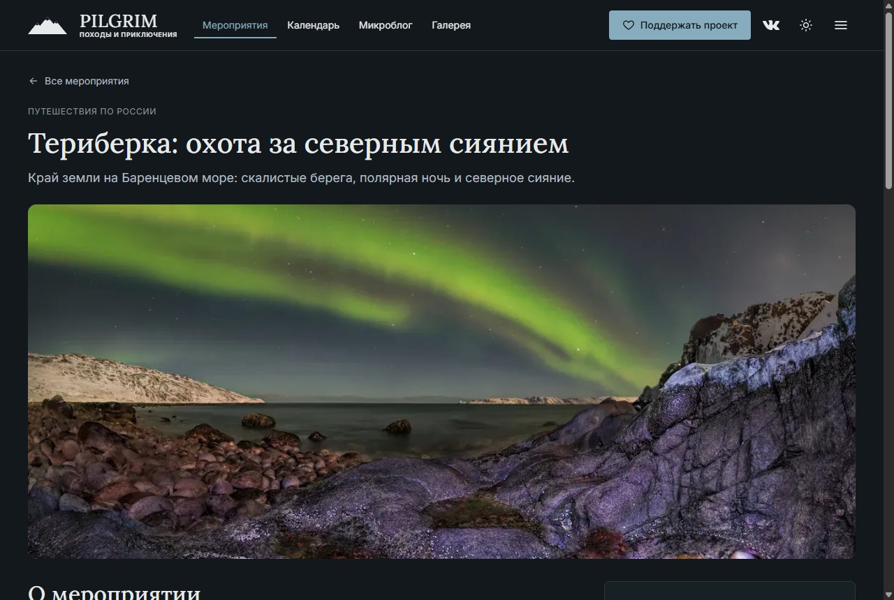

# PILGRIM — походы и приключения

Сайт сообщества PILGRIM: мероприятия и календарь, микроблог, фотогалерея, поддержка проекта и связь с сообществом ВКонтакте.

**Демо:** https://stazzz544.github.io/pilgrim/



<p>
  
  
</p>

## Что есть в демо

Это **демо-версия MVP**: фронтенд работает на демонстрационных данных и публикуется на GitHub Pages. Серверная часть (Django REST Framework, админка, PostgreSQL) подключится на следующем этапе. Интерфейс при этом переделывать не придётся: данные уже приходят через слой запросов в форме будущего API ([контракт](docs/api-contract.md)).

| Раздел         | Что умеет                                                                                                             |
| -------------- | --------------------------------------------------------------------------------------------------------------------- |
| Главная        | Ближайшие мероприятия, мини-календарь, «На этой неделе», заметки и галерея — по макету                               |
| Мероприятия    | Поиск, фильтр по направлениям и сложности, сортировка по дате, фильтры сохраняются в ссылке; архив прошедших          |
| Мероприятие    | Описание, программа, что взять, фотоотчёт, запись через чат ВК, добавление в календарь (.ics), похожие мероприятия     |
| Календарь      | Месяц с событиями, выбор дня, переход по месяцам                                                                      |
| Микроблог      | Лента заметок с фотографиями, просмотр фото, блок свежих записей ВКонтакте                                            |
| Галерея        | Альбомы по направлениям, просмотр фото с листанием стрелками и свайпом                                                |
| Поддержка      | Выбор суммы, разово или ежемесячно; вместо оплаты — демо-окно, платёжный сервис подключается вместе с бэкендом         |

Сайт адаптирован под телефоны, планшеты и компьютеры, есть светлая и тёмная тема.

Деление «предстоящие / архив» и отметка «сегодня» считаются по текущей дате посетителя, поэтому демо не устаревает.

## Стек

- **Фронтенд:** Next.js 16 (App Router, статический экспорт), TypeScript, CSS Modules, собственная дизайн-система на CSS-переменных — без CSS-фреймворков и UI-библиотек.
- **Деплой:** GitHub Actions → GitHub Pages. При каждом пуше в `main` запускаются lint, проверка типов и сборка.
- **Дальше по ТЗ:** Django + DRF, PostgreSQL, Docker Compose на VPS, HTTPS, резервные копии. План — в [`ROADMAP.md`](ROADMAP.md), этап B.

## Структура

| Папка            | Что внутри                                         |
| ---------------- | -------------------------------------------------- |
| `pilgrim_front/` | Фронтенд                                           |
| `pilgrim_back/`  | Бэкенд — следующий этап                            |
| `docs/`          | Контракт API и скриншоты                           |
| `ROADMAP.md`     | План работ и журнал выполнения                     |
| `CREDITS.md`     | Авторы и лицензии демонстрационных фотографий      |

## Запуск фронтенда

Нужен Node.js 24 (версия зафиксирована в `.nvmrc`).

```bash
cd pilgrim_front
npm install
npm run dev        # http://localhost:3000
```

| Команда              | Что делает                                 |
| -------------------- | ------------------------------------------ |
| `npm run dev`        | Сервер разработки                          |
| `npm run build`      | Статическая сборка в `pilgrim_front/out/`  |
| `npm run lint`       | ESLint                                     |
| `npm run type-check` | Проверка типов TypeScript                  |

Чтобы собрать сайт под подпапку, как на GitHub Pages, задайте префикс: `NEXT_PUBLIC_BASE_PATH=/pilgrim npm run build`.

## Фотографии

В демо используются свободно лицензированные фотографии с Wikimedia Commons. Авторы и лицензии перечислены в [`CREDITS.md`](CREDITS.md) и на странице «Авторы фотографий» на сайте. Перед запуском их заменят на фотоотчёты сообщества.
